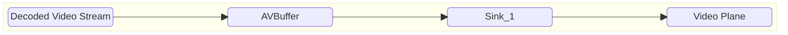
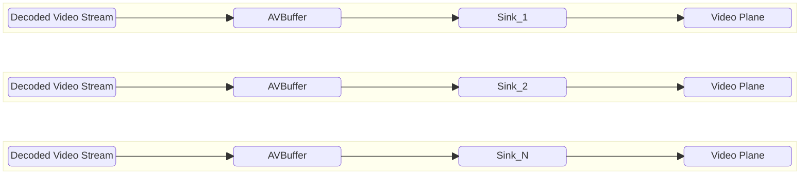
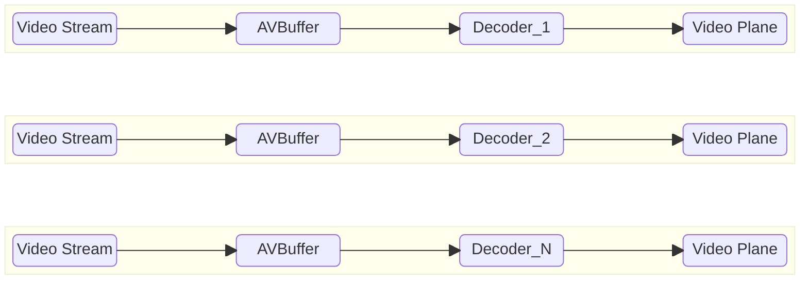

# Video Sink High Level Test Specification Document

## Table of Contents

- [Acronyms, Terms and Abbreviations](#acronyms-terms-and-abbreviations)
- [Introduction](#introduction)
- [Module Description](#module-description)
- [L2 Test Specification](#l2-test-specification)
- [L3 Test Specification](#l3-test-specification)

## Acronyms, Terms and Abbreviations

- `HAL`    - Hardware Abstraction Layer
- `API`    - Application Programming Interface
- `AIDL`   - Android Interface Definition Language
- `L2`     - Level 2 Testing
- `L3`     - Level 3 Testing
- `NA`     - Not Applicable
- `Caller` - Any user of the interface via the `APIs`
- `CB`     - Call-back function (suffix)
- `RDK`    - Reference Design Kit
- `EOS`    - End of Stream

## Introduction

This document provides an overview of the testing requirements for the Video Sink module. It outlines the scope of testing, objectives, testing levels and approaches, specific test requirements.

- Video Sink Interface Definitions - [Video Sink HAL](https://github.com/rdkcentral/rdk-halif-aidl/tree/0.22.0/videosink/current/com/rdk/hal/videosink)

- Video Sink Overview - [Video Sink Overview](https://wiki.rdkcentral.com/display/RDKHAL/Video+Sink)

## Module Description
The Video Sink `HAL` service provides the interfaces for the video frame queue and deliver video frames to a video plane under the timing of the vendor AV sync.

## L2 Test Specification

|Test|Description|HAL APIs|
|----|-----------|--------|
|Set and Get Video Sink Properties|<ul><li>Read available Video Sinks using `IVideoSinkManager` class</li><li>Loop through available video sinks</li><li>Use the `setProperty` method to set all the supported value provided in [configuration YAML](../../profiles/videosink-properties.yaml)</li><li>Get the property value using `getProperty` of `IVideoSink` and verify the HAL returns the set Value from the YAML file</li></ul>|<ul><li>IVideoSinkManager - getVideoSinkIds, getVideoSink</li><li>IVideoSink - open, getProperty, close </li><li>IVideoSinkController - setProperty</li></ul>|
|Set and Get Video Decoder Link|<ul><li>Read available Video Sinks using `IVideoSinkManager` class</li><li>Open each sink using `IVideoSink.open(controllerListener)` to obtain an `IVideoSinkController`</li><li>Set the Video Decoder ID using `IVideoSinkController.setVideoDecoder(videoDecoderId)`</li><li>Verify the linked decoder ID using `IVideoSinkController.getVideoDecoder()` matches the value that was set</li><li>Set to `IVideoDecoder.Id.UNDEFINED` and verify the decoder is unlinked</li><li>Close the sink</li></ul>|<ul><li>IVideoSinkManager - getVideoSinkIds, getVideoSink</li><li>IVideoSink - open, close</li><li>IVideoSinkController - setVideoDecoder, getVideoDecoder</li></ul>|
|States of VideoSink|<ul><li>Read supported video sinks using `IVideoSinkManager` class calling `getVideoSinkIds`</li><li>Loop through supported video sinks</li><li>register  event listeners using `registerEventListener`</li><li>Ensure state transitions (`opening-> Ready-> Starting-> started -> Flushing-> started-> stopping -> closing -> Closed`)</li><li>call `open` in `IVideoSinkController` to transition to the state `READY`</li><li>Observe the `OnStateChangeEvent` in the  `IVideoSinkEventListener` to get `OPENING` and `READY` states</li> <li>Once in `READY` state query the Sink state using `getState` and verify</li><li>call `start` in `IVideoSinkController` to transition to the state `STARTED`</li><li>Observe the `OnStateChangeEvent` in the  `IVideoSinkEventListener` to get `STARTING` and `STARTED` states</li> <li>Once in `STARTED` state query the Sink state using `getState` and verify</li><li>call `flush` in `IVideoSinkController` to go through transitioning state `FLUSHING`</li><li>Observe the `OnStateChangeEvent` in the  `IVideoSinkEventListener` to get `FLUSHING` and `STARTED` states</li> <li>Once in `STARTED` state query the Sink state using `getState` and verify</li><li>call `close` in `IVideoSinkController` to transition to the state `CLOSED`</li><li>Observe the `OnStateChangeEvent` in the  `IVideoSinkEventListener` to get `STOPPING`, `CLOSING` and `CLOSED` states</li> <li>Once in `CLOSED` state query the Sink state using `getState` and verify</li></ul>|<ul><li>IVideoSinkManager - getVideoSinkIds, getVideoSink</li><li>IVideoSink - open, getState, registerEventListener, unregisterEventListener, close </li><li>IVideoSinkController - start, stop, flush</li></ul>|
|Attach and Detach Clock ID|<ul><li>Read supported video sinks using `IVideoSinkManager` class calling `getVideoSinkIds`</li><li>Loop through supported video sinks</li><li>register  event listeners using `registerEventListener`</li><li>call `open` in `IVideoSinkController` to transition to the state `READY`</li><li>Attach the clock id and verify</li><li>call `start` in `IVideoSinkController` to transition to the state `STARTED`</li><li>Attach the clock id and verify</li><li>call `close`</li></ul>|<ul><li>IVideoSinkManager - getVideoSinkIds, getVideoSink</li><li>IVideoSink - open, getState, registerEventListener, unregisterEventListener, close </li><li>IVideoSinkController - start, stop, attachClock, detachClock, getClock</li></ul>|

### L3 Test Specification
### Prerequisites

#### Video Decoder

Decoded Video frames are supplied to the Video Sink queue during non-tunnel mode testing, which necessitates a pre-validated Video Decoder module. Therefore, the VideoDecoder must successfully pass VTS L1, L2, and L3 testing before being used in the Video Sink tests

#### AV Buffer

Av buffer provides frames buffers to the Video sink during non-tunnel testing, which necessitates a pre-validated AVBuffer module. Therefore, the AVBuffer must successfully pass VTS L1, L2, and L3 testing before being used in the Video Sink tests

### Feature List

VTS L3 validates all the Video Sink features in both sequential and concurrent modes (if the platform supports multiple sinks) as represented below.

#### Sequential Sink Playback

The Sequential Sink Playback test evaluates each video sink individually, one after another, to ensure functional correctness across all supported features. This approach helps isolate issues and verify that every sink instance performs as expected in a standalone environment.

##### Non-Tunnel
In non-tunnel mode Decoder should set Sink to nom-tunnel mode, Decoded video frames are passed to the linked video sink via AVbuffer for rendering.

##### Tunnel
In tunnel mode Decoder should set Sink to tunnel mode, Decoded video frames are passed directly to the linked video plane for rendering.

#### Concurrent Sink Playback

The Concurrent Sink Playback test assesses the system's ability to handle multiple video sink operating simultaneously, each configured with different supported features. This test is designed to validate the robustness, resource management, and feature compatibility of the platform under concurrent load, and is applicable only if the platform supports multiple sink instances.

##### Non-Tunnel

##### Tunnel
In tunnel mode Decoder should set Sink to tunnel mode, Decoded video frames are passed directly to the linked video plane for rendering.

The following table outlines the core features validated in the L3 test phase

|#|Testing Feature|Description|
|-|---------------|-----------|
|1|Tunnel/Non-Tunnel|Executes the sink in tunnel mode. Based on video decoder configuration, the sink chooses between tunnel and non-tunnel operation. In tunnel mode, the test validates by reading the metrics data like (METRIC_FRAMES_RECEIVED, METRIC_FRAMES_PRESENTED, METRIC_FRAMES_DROPPED_FRC etc).|
|2|EOS|Test the sink's handling of end-of-stream. After queuing the final video frame via `queueVideoFrame()`, call `IVideoSinkController.signalEndOfStream()` to signal no further frames will be queued. The sink must render all already-queued frames and then fire `IVideoSinkControllerListener.onEndOfStream(nsPresentationTime)` with the presentation time of the final rendered frame. If no frames are queued at signal time, the callback is still fired with `IAVClock.UNDEFINED_TIME`.|
|3|Underflow|Test the sink's handling of video underflow. Sink should raise an event during a video buffer underflow condition.|
|4|Video Resume|Verifies Sink can resume video playback after an underflow occurred in the video buffer. Sink should raise the event `onVideoResumed` after recovering from underflow.|
|5|Flush|Tests the sink’s flush functionality. The sink should discard any queued buffers and resume playback with the appropriate behavior—either displaying the last frame until a new one is received (hold last frame), or not displaying it (no hold). Sink will raise the `onFlushComplete` event.|
|6|Discard Frame Till|Tests the sink's ability to discard incoming frames up to a specified presentation time (PTS). This can be validated by comparing the expected number of discarded frames with the metrics (e.g., number of frames dropped).|
|7|Queue Depth|Verifies the sink's queue depth by supplying frames and checking the reported queue depth property.|
|8|Frames Dropped|Verifies the number of frames dropped during playback using sink metrics while playing a stream with known frame drop issues.|
|9|Frames Dropped due to frame rate change|Verifies the number of frames dropped due to a frame rate mismatch between stream and playback rate. Set playback frame rate lower than the stream rate to validate.|
|10|Frames Repeated due to frame rate change|Verifies the number of frames repeated due to frame rate mismatch. Set playback frame rate higher than the stream rate to validate.|
|11|Multi Instance|If the platform supports multiple sinks, this test runs multiple instances simultaneously to validate independent output and associated metrics.|

| # | Test | Tunnel | EOS | Underflow | Video Resume | Flush | Discard Frame Till | Queue Depth | Frames Dropped | Frames Dropped due to FRC | Frames Repeated due to FRC | Multi Instance |
|---|------|--------|-----|-----------|---------------|-------|--------------------|--------------|----------------|-----------------------------|------------------------------|----------------|
| 1 | VSink_Sequential_NonTunnel | ✘ | ✘ | ✘ | ✘ | ✘ | ✘ | ✘ | ✘ | ✘ | ✘ | ✘ |
| 2 | VSink_Sequential_NonTunnel_EOS | ✘ | ✔ | ✘ | ✘ | ✘ | ✘ | ✘ | ✘ | ✘ | ✘ | ✘ |
| 3 | VSink_Sequential_NonTunnel_Underflow | ✘ | ✘ | ✔ | ✘ | ✘ | ✘ | ✘ | ✘ | ✘ | ✘ | ✘ |
| 4 | VSink_Sequential_NonTunnel_VideoResume | ✘ | ✘ | ✘ | ✔ | ✘ | ✘ | ✘ | ✘ | ✘ | ✘ | ✘ |
| 5 | VSink_Sequential_NonTunnel_Flush | ✘ | ✘ | ✘ | ✘ | ✔ | ✘ | ✘ | ✘ | ✘ | ✘ | ✘ |
| 6 | VSink_Sequential_NonTunnel_DiscardFrameTill | ✘ | ✘ | ✘ | ✘ | ✘ | ✔ | ✘ | ✘ | ✘ | ✘ | ✘ |
| 7 | VSink_Sequential_NonTunnel_QueueDepth | ✘ | ✘ | ✘ | ✘ | ✘ | ✘ | ✔ | ✘ | ✘ | ✘ | ✘ |
| 8 | VSink_Sequential_NonTunnel_FramesDropped | ✘ | ✘ | ✘ | ✘ | ✘ | ✘ | ✘ | ✔ | ✘ | ✘ | ✘ |
| 9 | VSink_Sequential_NonTunnel_FramesDroppedForFRC | ✘ | ✘ | ✘ | ✘ | ✘ | ✘ | ✘ | ✘ | ✔ | ✘ | ✘ |
|10 | VSink_Sequential_NonTunnel_FramesRepeatedForFRC | ✘ | ✘ | ✘ | ✘ | ✘ | ✘ | ✘ | ✘ | ✘ | ✔ | ✘ |
|11 | VSink_Sequential_Tunnel | ✔ | ✘ | ✘ | ✘ | ✘ | ✘ | ✘ | ✘ | ✘ | ✘ | ✘ |
|12 | VSink_Sequential_Tunnel_EOS | ✔ | ✔ | ✘ | ✘ | ✘ | ✘ | ✘ | ✘ | ✘ | ✘ | ✘ |
|13 | VSink_Sequential_Tunnel_Underflow | ✔ | ✘ | ✔ | ✘ | ✘ | ✘ | ✘ | ✘ | ✘ | ✘ | ✘ |
|14 | VSink_Sequential_Tunnel_VideoResume | ✔ | ✘ | ✘ | ✔ | ✘ | ✘ | ✘ | ✘ | ✘ | ✘ | ✘ |
|15 | VSink_Sequential_Tunnel_Flush | ✔ | ✘ | ✘ | ✘ | ✔ | ✘ | ✘ | ✘ | ✘ | ✘ | ✘ |
|16 | VSink_Sequential_Tunnel_DiscardFrameTill | ✔ | ✘ | ✘ | ✘ | ✘ | ✔ | ✘ | ✘ | ✘ | ✘ | ✘ |
|17 | VSink_Sequential_Tunnel_QueueDepth | ✔ | ✘ | ✘ | ✘ | ✘ | ✘ | ✔ | ✘ | ✘ | ✘ | ✘ |
|18 | VSink_Sequential_Tunnel_FramesDropped | ✔ | ✘ | ✘ | ✘ | ✘ | ✘ | ✘ | ✔ | ✘ | ✘ | ✘ |
|19 | VSink_Sequential_Tunnel_FramesDroppedForFRC | ✔ | ✘ | ✘ | ✘ | ✘ | ✘ | ✘ | ✘ | ✔ | ✘ | ✘ |
|20 | VSink_Sequential_Tunnel_FramesRepeatedForFRC | ✔ | ✘ | ✘ | ✘ | ✘ | ✘ | ✘ | ✘ | ✘ | ✔ | ✘ |
|21 | Sink_MultiInstance_NonTunnel | ✘ | ✘ | ✘ | ✘ | ✘ | ✘ | ✘ | ✘ | ✘ | ✘ | ✔ |
|22 | Sink_MultiInstance_NonTunnel_EOS | ✘ | ✔ | ✘ | ✘ | ✘ | ✘ | ✘ | ✘ | ✘ | ✘ | ✔ |
|23 | Sink_MultiInstance_NonTunnel_Underflow | ✘ | ✘ | ✔ | ✘ | ✘ | ✘ | ✘ | ✘ | ✘ | ✘ | ✔ |
|24 | Sink_MultiInstance_NonTunnel_VideoResume | ✘ | ✘ | ✘ | ✔ | ✘ | ✘ | ✘ | ✘ | ✘ | ✘ | ✔ |
|25 | Sink_MultiInstance_NonTunnel_Flush | ✘ | ✘ | ✘ | ✘ | ✔ | ✘ | ✘ | ✘ | ✘ | ✘ | ✔ |
|26 | Sink_MultiInstance_NonTunnel_DiscardFrameTill | ✘ | ✘ | ✘ | ✘ | ✘ | ✔ | ✘ | ✘ | ✘ | ✘ | ✔ |
|27 | Sink_MultiInstance_NonTunnel_QueueDepth | ✘ | ✘ | ✘ | ✘ | ✘ | ✘ | ✔ | ✘ | ✘ | ✘ | ✔ |
|28 | Sink_MultiInstance_NonTunnel_FramesDropped | ✘ | ✘ | ✘ | ✘ | ✘ | ✘ | ✘ | ✔ | ✘ | ✘ | ✔ |
|29 | Sink_MultiInstance_NonTunnel_FramesDroppedForFRC | ✘ | ✘ | ✘ | ✘ | ✘ | ✘ | ✘ | ✘ | ✔ | ✘ | ✔ |
|30 | Sink_MultiInstance_NonTunnel_FramesRepeatedForFRC | ✘ | ✘ | ✘ | ✘ | ✘ | ✘ | ✘ | ✘ | ✘ | ✔ | ✔ |
|31 | Sink_MultiInstance_Tunnel | ✔ | ✘ | ✘ | ✘ | ✘ | ✘ | ✘ | ✘ | ✘ | ✘ | ✔ |
|32 | Sink_MultiInstance_Tunnel_EOS | ✔ | ✔ | ✘ | ✘ | ✘ | ✘ | ✘ | ✘ | ✘ | ✘ | ✔ |
|33 | Sink_MultiInstance_Tunnel_Underflow | ✔ | ✘ | ✔ | ✘ | ✘ | ✘ | ✘ | ✘ | ✘ | ✘ | ✔ |
|34 | Sink_MultiInstance_Tunnel_VideoResume | ✔ | ✘ | ✘ | ✔ | ✘ | ✘ | ✘ | ✘ | ✘ | ✘ | ✔ |
|35 | Sink_MultiInstance_Tunnel_Flush | ✔ | ✘ | ✘ | ✘ | ✔ | ✘ | ✘ | ✘ | ✘ | ✘ | ✔ |
|36 | Sink_MultiInstance_Tunnel_DiscardFrameTill | ✔ | ✘ | ✘ | ✘ | ✘ | ✔ | ✘ | ✘ | ✘ | ✘ | ✔ |