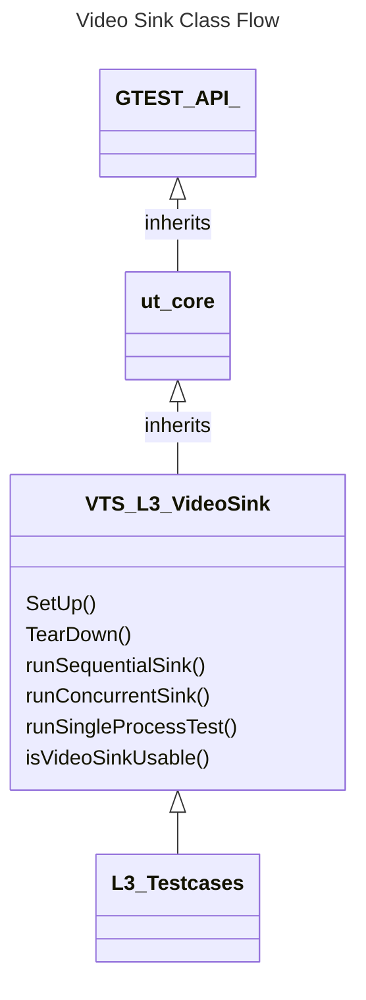
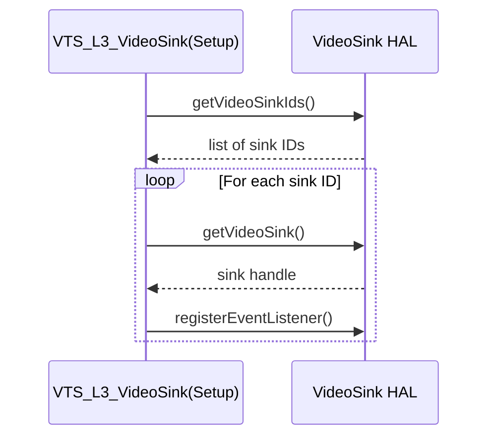
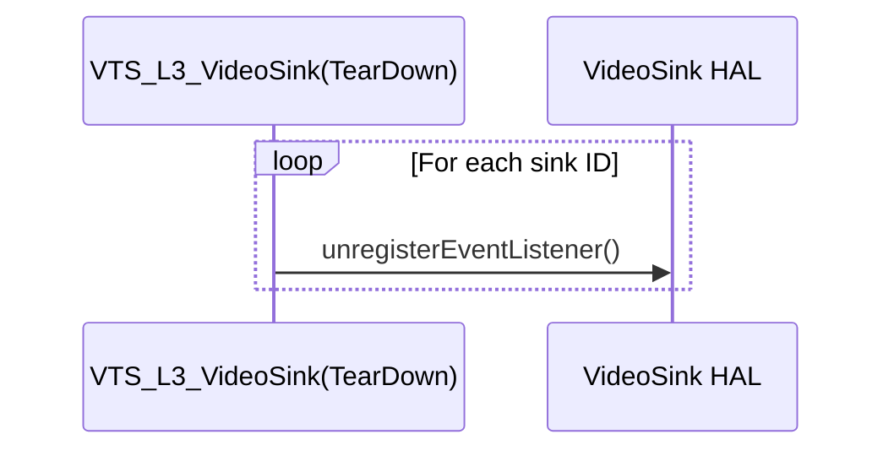
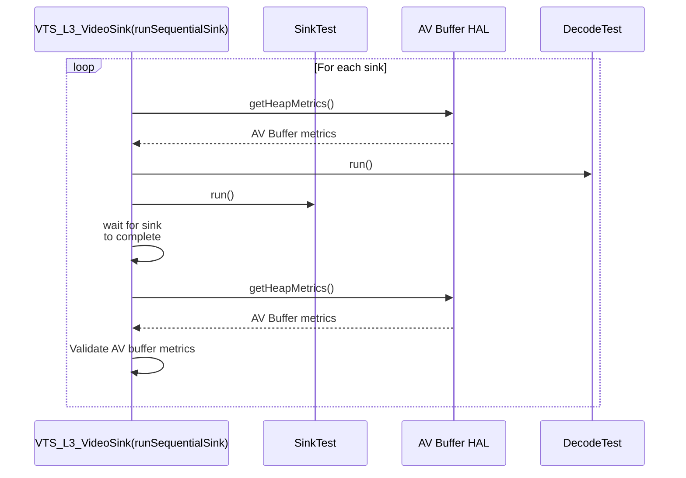
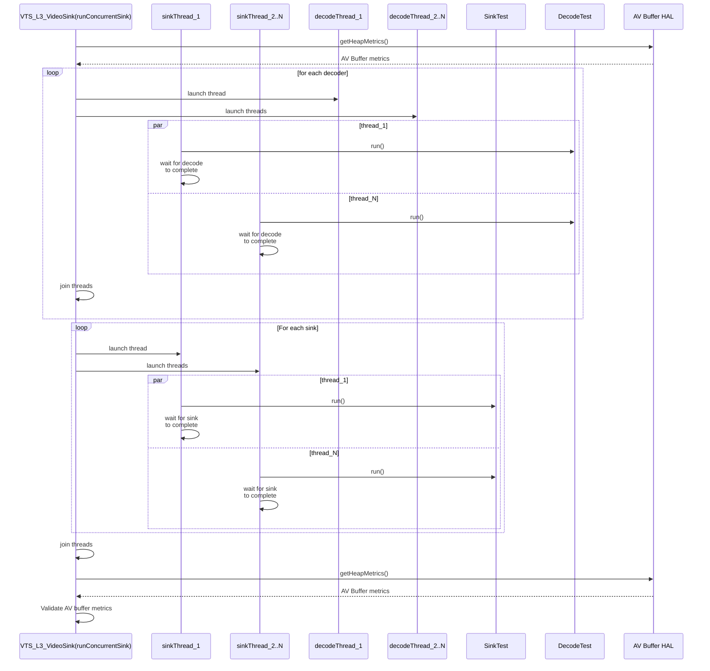
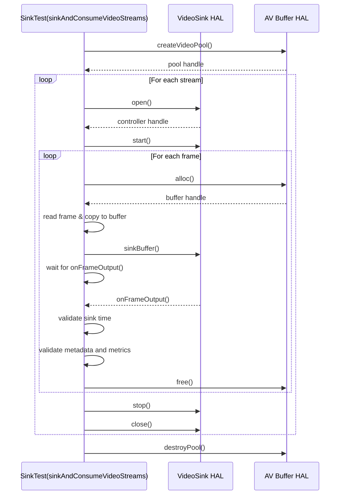
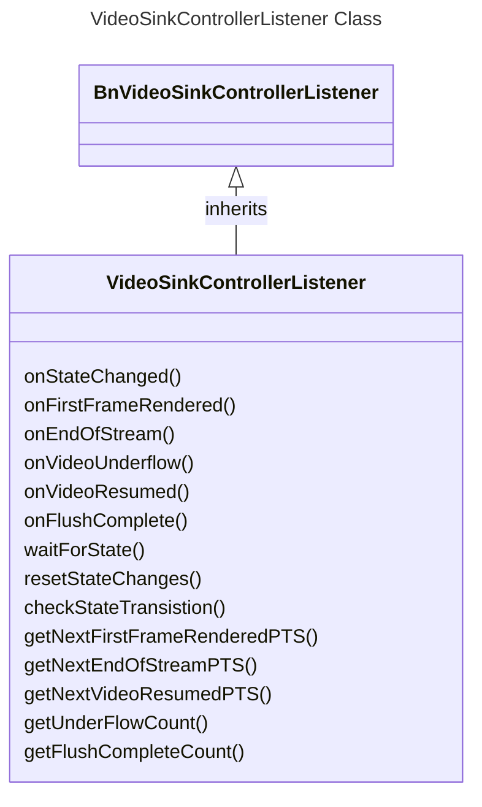
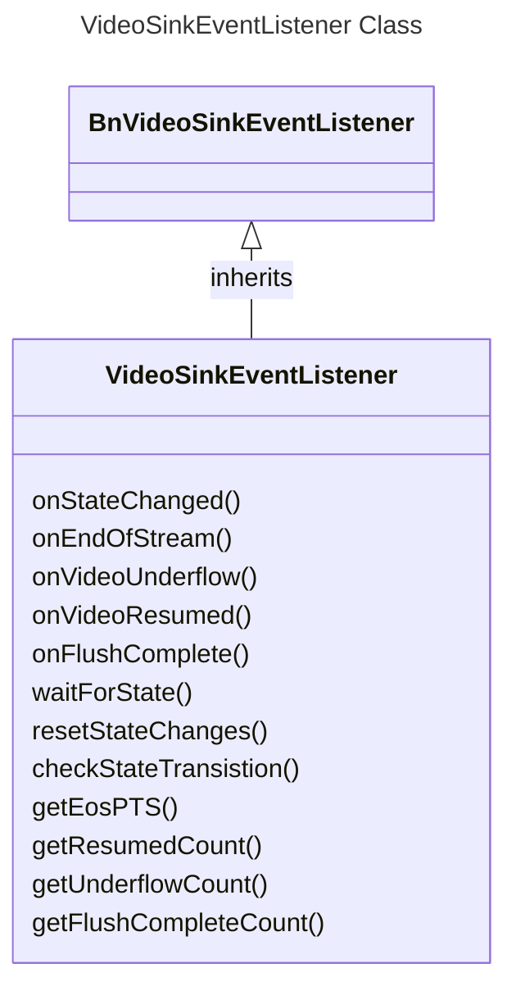

# Video Sink L3 Low Level Test Specification and Procedure Documentation

## Table of Contents

- [Overview](#overview)
- [Acronyms, Terms and Abbreviations](#acronyms-terms-and-abbreviations)
- [References](#references)
- [Test Configuration](#test-configuration)
- [Class Design](#class-design)
- [Common Validation Functions](#common-validation-functions)
- [L3 Tests](#l3-tests)

## Acronyms, Terms and Abbreviations

- `HAL` \- Hardware Abstraction Layer, may include some common components
- `UT`  \- Unit Test(s)
- `YAML` \- Yet Another Markup Language
- `PTS` \- Presentation Time Stamp
- `EOS` \- End of Stream
- `URL` \- Uniform Resource Locator

## Overview

This document outlines the L3 test design for the Video Sink module.

## References

- Video Sink High Level Test Specification - [VideoSink_High-Level_TestSpecification.md](VideoSini_High-Level_TestSpecification.md)
- Video Sink Interface Definitions - [Video Sink HAL](https://github.com/rdkcentral/rdk-halif-aidl/tree/0.23.0/videosink/0.3.0.0/com/rdk/hal/videosink)
- Video Sink Overview - [Video Sink Overview](https://rdkcentral.github.io/rdk-halif-aidl/halif/Video_sink/current/Video_sink/)

### AIDL 0.23.0 platform-selected playback

L3 tests are named by operation, without tunnel/non-tunnel or secure/non-secure
variants. Each sink is associated with its decoder using `setVideoDecoder()`
and started before decoding begins. After the decoder reaches `STARTED`, the
test queries `IVideoDecoder.getCurrentOperationalMode()`.

Secure input is used only when both the decoder and sink advertise
`Capabilities.supportsSecure`; otherwise the decoder is opened non-secure.
Sequential cases exercise every supported decoder/sink combination. Concurrent
cases select independent decoder/sink/clock pairs and check each heap they use.

- `NON_TUNNELLED`: validate each output handle, then pass it to `queueVideoFrame()`.
  Ownership transfers only on acceptance. Rejected handles are freed by the client;
  accepted buffers are freed by the sink.
- `TUNNELLED`: require `-1` in `onFrameOutput()`. Do not call `queueVideoFrame()`;
  the vendor delivers frames internally and owns buffer cleanup.
- Both paths validate presentation callbacks, EOS sequencing, flush/discard
  operations and metrics. Middleware signals sink EOS after decoder EOS.
- Client queue back-pressure and client-side underflow delay injection apply only
  to non-tunnelled output. Tunnelled cases still exercise vendor-path playback
  and cleanup, and explicitly log that those client-side probes are inapplicable.

Decoder output metadata is retained when unchanged, and all metadata fields are
forwarded. Pending client-owned handles are drained before closing sessions.
The decoder remains open until sink playback and cleanup complete.

## Class Design

This test suite is designed using an object-oriented approach, leveraging the C++ variant of the `ut-core` testing framework. The following class structure and interaction model supports robust test orchestration, concurrent execution, and sink validation.

### Primary Classes

|#|Class|Description|
|-|-----|-----------|
|1|VTS_L3_VideoSink|Test class which contains the test cases implementation|
|2|SinkTest|Sink test helper class|
|3|VideoSinkControllerListener|VideoSink Controller listener class|
|4|VideoSinkEventListener|VideoSink Event listener class|

### VTS_L3_VideoSink Class

The L3 Video sink tests are implemented using the C++ variant of `ut-core`. For more information on the framework, refer to [ut-core](https://github.com/rdkcentral/ut-core/blob/4.7.0/README.md)

The following class diagram shows the inheritance structure and configuration dependencies for the test suite:

#### VTS_L3_VideoSink Class Functions

The class overrides `SetUp()` and `TearDown()` from `ut_core` to handle initialization and clean-up common to all test cases

|#|Function|Arguments|Description|HAL API|
|-|--------|---------|-----------|-------|
|1|Setup|None|Initializes the test by acquiring service handles, supported sink IDs, sink capabilities, and registering event listeners|`getVideoSinkIds()` `getVideoSink()` `registerEventListener()`|
|2|TearDown|None|Cleans up by unregistering event listeners|`unregisterEventListener()`|
|3|runSequentialSink|vector\<testConfiguration_t\>& configuration |Sinks streams using all sinks sequentially using `SinkTest` Class|`getHeapMetrics()`|
|4|runConcurrentSink|vector\<testConfiguration_t\>& configuration |Launches multiple threads to sink streams concurrently using `SinkTest` Class|`getHeapMetrics()`|
|5|runSingleProcessTest|char *testName bool concurrentMode|If `concurrentMode` is enabled, this function invokes `runConcurrentSink`; otherwise, it calls `runSequentialSink`||

#### Setup

The following sequence diagram illustrates the flow of the `Setup` function:

#### TearDown

#### runSequentialSink

The following sequence diagram illustrates the flow of the `runSequentialSink` function:

#### runConcurrentSink

The following sequence diagram illustrates the flow of the `runConcurrentSink` function:

### SinkTest Class

This class includes methods for testing individual streams and frames.

|#|Function|Arguments|Description|HAL API|
|-|--------|---------|-----------|-------|
|1|sinkAndConsumeVideoStreams|bool validateMetrics|Sinks and consumes the Video frames sequentially|`createVideoPool()` `alloc()` `free()` `destroyPool()` `open()` `start()` `sinkBuffer()` `stop()` `close()`|
|2|run|bool validateMetrics|calls sinkAndConsumeVideoStreams||
|3|getSinkMetrics|int32_t &framesSinkd int32_t &sinkErrors int32_t &framesDropped|Gets the sink metrics|`getProperty()`|

#### sinkAndConsumeVideoStreams

The following sequence diagram illustrates the flow of the `sinkAndConsumeVideoStreams` function:

### VideoSinkControllerListener Class

This class is responsible for handling call-backs from the VideoSink `HAL`.

#### VideoSinkControllerListener Class Functions

|#|Function|Arguments|Description|
|-|--------|---------|-----------|
|1|onStateChanged|State oldState State newState|Callback for state changes. Records the transition and notifies waiting threads.|
|2|onFirstFrameRendered|int64_t nsPresentationTime|Callback for first frame rendered. Enqueues the PTS and notifies waiting threads.|
|3|getNextFirstFrameRenderedPTS|int64_t &firstFramePTS|Waits for and retrieves the next first frame rendered PTS from the queue.|
|4|onEndOfStream|int64_t nsPresentationTime|Callback for end of stream. Enqueues the PTS and notifies waiting threads.|
|5|getNextEndOfStreamPTS|int64_t &endOfStreamPTS|Waits for and retrieves the next end of stream PTS from the queue.|
|6|onVideoUnderflow|None|Callback for Video underflow event. Increments the underflow count.|
|7|getUnderFlowCount|bool reset|Returns the current underflow count; resets it if requested.|
|8|onVideoResumed|int64_t nsPresentationTime|Callback for Video resumed event. Enqueues the PTS.|
|9|getNextVideoResumedPTS|int64_t &VideoResumedPTS|Waits for and retrieves the next Video resumed PTS from the queue.|
|10|onFlushComplete|None|Callback for flush complete event. Increments the flush complete count.|
|11|getFlushCompleteCount|bool reset|Returns the current flush complete count; resets it if requested.|
|12|waitForState|State desiredState chrono::milliseconds timeout|Waits for the state to change to the desired state or until timeout.|
|13|resetStateChanges|None|Clears the recorded state transitions.|
|14|checkStateTransistion|State expOldState State expNewState|Checks if the expected state transition has occurred.|

### VideoSinkEventListener Class

This class implements the BnVideoSinkEventListener interface and is responsible for receiving and queuing events emitted by the VideoSink `HAL`.

#### VideoSinkEventListener Class Functions

|#|Function|Arguments|Description|
|-|--------|---------|-----------|
|1|onStateChanged|State oldState State newState|Callback for state changes. Records the transition and notifies waiting threads.|
|2|onFirstFrameRendered|int64_t nsPresentationTime|Callback for first frame rendered. Enqueues the PTS and notifies waiting threads.|
|3|getNextFirstFrameRenderedPTS|int64_t &firstFramePTS|Waits for and retrieves the next first frame rendered PTS from the queue.|
|4|onEndOfStream|int64_t nsPresentationTime|Callback for end of stream. Enqueues the PTS and notifies waiting threads.|
|5|getNextEndOfStreamPTS|int64_t &endOfStreamPTS|Waits for and retrieves the next end of stream PTS from the queue.|
|6|onVideoUnderflow|None|Callback for Video underflow event. Increments the underflow count.|
|7|getUnderFlowCount|bool reset|Returns the current underflow count; resets it if requested.|
|8|onVideoResumed|int64_t nsPresentationTime|Callback for Video resumed event. Enqueues the PTS.|
|9|getNextVideoResumedPTS|int64_t &VideoResumedPTS|Waits for and retrieves the next Video resumed PTS from the queue.|
|10|onFlushComplete|None|Callback for flush complete event. Increments the flush complete count.|
|11|getFlushCompleteCount|bool reset|Returns the current flush complete count; resets it if requested.|
|12|waitForState|State desiredState chrono::milliseconds timeout|Waits for the state to change to the desired state or until timeout.|
|13|resetStateChanges|None|Clears the recorded state transitions.|
|14|checkStateTransistion|State expOldState State expNewState|Checks if the expected state transition has occurred.|

## Common Validation Functions

These functions provide standard mechanisms for validating the output and behaviour of the Video sink under test

### Validate AV Buffers

This check ensures that both the test suite and the sink HAL properly release allocated Video buffers. It compares memory usage at the beginning and end of each test using the `getHeapMetrics()` API to confirm no memory leaks or unreleased buffers remain.

### Sink Events

This check verifies that the `HAL` correctly triggers the expected call-backs for underflow, resume, end of stream (EOS), first frame rendered, and flush events.

## L3 Tests

The L3 tests validate the functional correctness and performance of the VideoSink HAL by simulating real-world decoding workflows. Each test calls `runSingleProcessTest` with different parameters.

| # | Test | Configuration |
|---|------|---------------|
| 1 | `VSink_Sequential` | `Sink_Decode` |
| 2 | `VSink_Sequential_EOS` | `Sink_EOS` |
| 3 | `VSink_Sequential_Underflow` | `Sink_Underflow` |
| 4 | `VSink_Sequential_Flush` | `Sink_Flush` |
| 5 | `VSink_Sequential_DiscardFramesUntil` | `Sink_DiscardFramesUntil` |
| 6 | `VSink_Sequential_BackPressure` | `Sink_BackPressure` |
| 7 | `VSink_Concurrent` | `Sink_Decode` |
| 8 | `VSink_Concurrent_EOS` | `Sink_EOS` |
| 9 | `VSink_Concurrent_Underflow` | `Sink_Underflow` |
| 10 | `VSink_Concurrent_Flush` | `Sink_Flush` |
| 11 | `VSink_Concurrent_DiscardFramesUntil` | `Sink_DiscardFramesUntil` |
| 12 | `VSink_Concurrent_BackPressure` | `Sink_BackPressure` |
